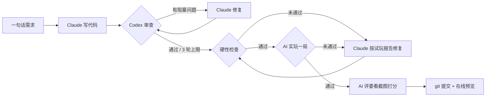
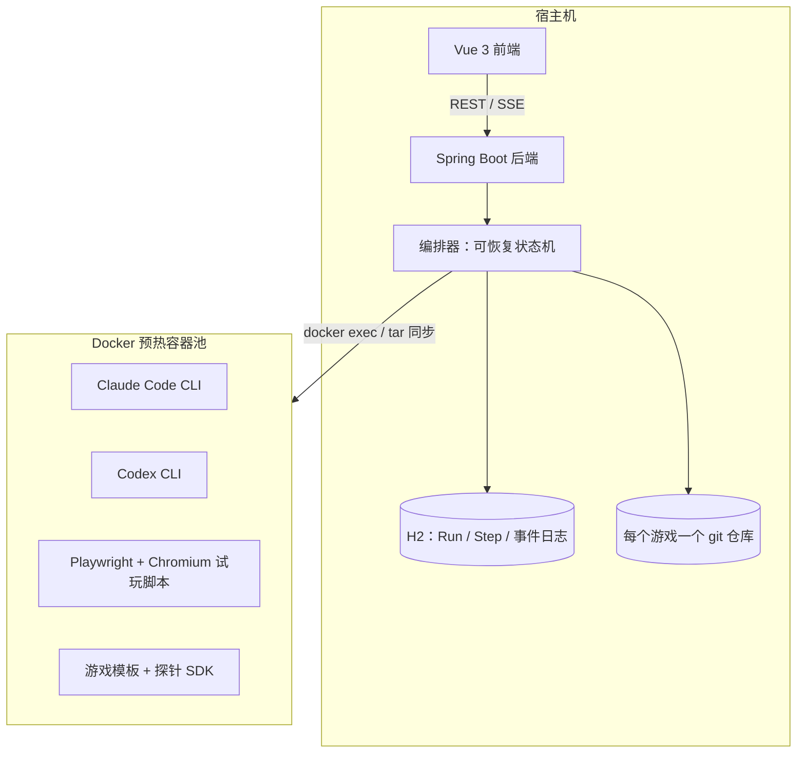

# PlayForge：一句话生成真的能玩的小游戏

输入一句话，比如"一个躲陨石的太空飞船游戏"，PlayForge 会让 **Claude 写代码、Codex 审查、AI 试玩员在真实浏览器里亲自玩一局**。发现问题就自动打回修复，最终得到一个验证过、能直接玩的 H5 小游戏；最后再由 AI 评委看截图给出好玩度建议。

**👉 在线作品展：https://lpzams.github.io/playforge/**（可以直接玩，也能展开看每个游戏是怎么一步步生成的）

## 和"AI 生成网页"有什么不同

大多数代码生成平台把"编译通过"当作成功。PlayForge 关心的是**生成出来的东西能不能用**：

- **多 Agent 交叉检查**：Claude 写代码，Codex 独立审查。阻塞问题会打回修复，审查意见冲突时以客观的试玩结果为准。
- **AI 真的去玩**：每个游戏都必须实现一个探针接口 `window.__GAME_PROBE__`。试玩脚本用 Playwright 打开游戏，读取状态、模拟按键、截图，检查能否加载、画面是否空白、按键有没有反应、能否重新开始、有没有报错。
- **AI 亲自玩一局**：硬性检查通过后，Claude 读游戏代码，写一段 Playwright 试玩脚本，像玩家一样玩一局（例如贪吃蛇会自己追着食物走），按需求断言"吃到食物会加分""撞墙会结束""空格能重开"。断言由平台记录，不靠模型自己说"通过了"；脚本自身出错只算"无结论"，不会冤枉一个好游戏。
- **AI 评委**：最后由 Claude 看试玩截图，从契合度、难度、画面、反馈感打分并给出改进建议。只做参考，不卡门。
- **失败就修**：硬性检查或 AI 实玩没通过的具体原因（例如"按住左键 400ms，玩家位置没有任何变化"）交给 Claude 修复，修好后重新试玩；修复轮数用完时以客观的硬性检查为准。

作品展的 4 个游戏里，Codex 审查拦下了 2 个真实 bug（接金币和打砖块都出现了"游戏结束后按空格不能直接重开"），都在交付前自动修好；每个游戏都由 AI 试玩员亲自玩过一局（7–9 项检查）。

## 工作流程



## 架构



## 技术要点

| 主题 | 做法 |
|---|---|
| 可恢复编排 | 用纯函数 `RunPlanner` 根据步骤历史决定下一步，每一步落库。进程崩溃或重启后从断点续跑，不重复提交。正常关机时 Run 保持"运行中"，下次启动自动恢复 |
| 护栏 | 审查最多 3 轮、试玩修复最多 2 次、单步看门狗超时、整次 Run 超时、限速错误指数退避重试、可随时取消 |
| 沙箱 | CLI 跑在 Docker 预热池里，每个容器只用一次就销毁。代码用 tar 流同步，拒绝 `..`、`.git` 的大小写变体、符号链接和 Windows 非法文件名。被强制关闭后残留的容器，下次启动时自动清理 |
| 试玩的可信度 | 先在不按键的情况下观察一段时间作为对照，按住按键期间持续采样，所以有东西自己在动时不会误判；能识别"只改变方向"的操作（贪吃蛇），某个键在当前状态下合理地无效时，先换个状态再试；只检测画布区域，不会被页面样式骗过。另有 15 个"故意出问题/容易误判的游戏"样本做回归 |
| AI 试玩员 | 确定性部分（脚本断言）卡门，不确定部分（评委打分）只报告：用工程手段约束大模型的不确定性。试玩脚本每次 Run 只写一次、修复后复用，评委只给最终通过的版本打分，控制额度消耗 |
| 安全 | 凭证只以环境变量名传入容器，事件流统一脱敏。预览运行在 CSP 沙箱里（不透明源），生成的游戏无法调用平台 API。前端把 AI 输出一律当纯文本渲染 |
| 实时 | SSE 推送全过程，支持 `Last-Event-ID` 断线续传；同一份事件日志也是作品展"生成过程"的数据来源 |

## 技术栈

- **后端**：Java 21、Spring Boot 3.5、MyBatis-Plus、H2 + Flyway、JGit、Docker CLI
- **AI**：Claude Code CLI（写代码）、Codex CLI（审查），都在容器里使用个人订阅
- **试玩**：Playwright + Chromium、自定义探针协议、pngjs
- **前端**：Vue 3、TypeScript、Vite（无 UI 组件库，和作品展同一套视觉）
- **测试**：后端 190+（JUnit 5，含真实 Docker 集成测试）、前端 30+（Vitest）

## 项目结构

```
backend/    Spring Boot 后端：编排、引擎、沙箱、试玩、API
web/        Vue 3 本地平台（新建、实时过程、预览、继续修改）
sandbox/    沙箱镜像：Dockerfile、游戏模板 + 探针 SDK、试玩脚本 run.mjs、故障样本
showcase/   作品展：导出脚本 + 静态站点（GitHub Pages）
docs/       需求决策、设计文档、分阶段实施计划、运行手册
```

## 运行

见 [docs/runbook.md](docs/runbook.md)。简要步骤：

1. 构建沙箱镜像：`docker build --build-arg NPM_REGISTRY=https://registry.npmmirror.com/ -t playforge-sandbox:p4 sandbox`
2. 准备凭证：`claude setup-token` → 用户环境变量 `PLAYFORGE_CLAUDE_TOKEN`；执行 `codex login`
3. 构建前端：`cd web && npm install && npm run build`
4. 启动后端：`cd backend && ./mvnw spring-boot:run -Dspring-boot.run.profiles=real`
5. 打开 http://localhost:8090/

## 文档

- [需求与关键决策](docs/decisions.md)：为什么选这个题目，每个技术选择的取舍
- [方案设计](docs/superpowers/specs/2026-11-08-playforge-design.md)
- 分阶段实施计划：[P1 编排核心](docs/superpowers/plans/2026-11-08-p1-orchestration-core.md) · [P2 真实引擎 + 沙箱](docs/superpowers/plans/2026-11-09-p2-real-engines-sandbox.md) · [P3 AI 试玩](docs/superpowers/plans/2026-11-10-p3-ai-playtest.md) · [P4 前端](docs/superpowers/plans/2026-11-15-p4-web-frontend.md) · [P5a AI 试玩员](docs/superpowers/plans/2026-11-16-p5a-ai-playtester.md) · [P5b 本地平台改版](docs/superpowers/plans/2026-11-16-p5b-local-platform.md)
- [运行手册与验收记录](docs/runbook.md)
